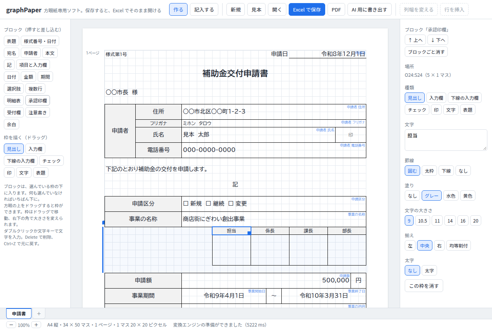
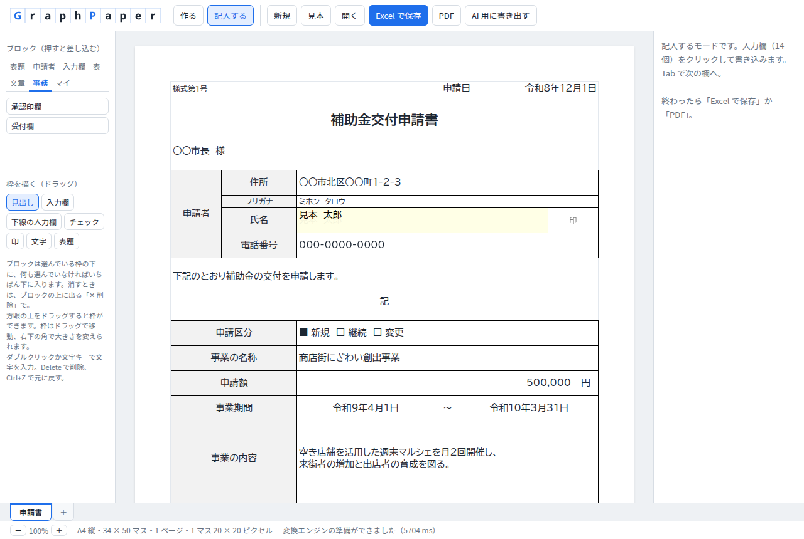
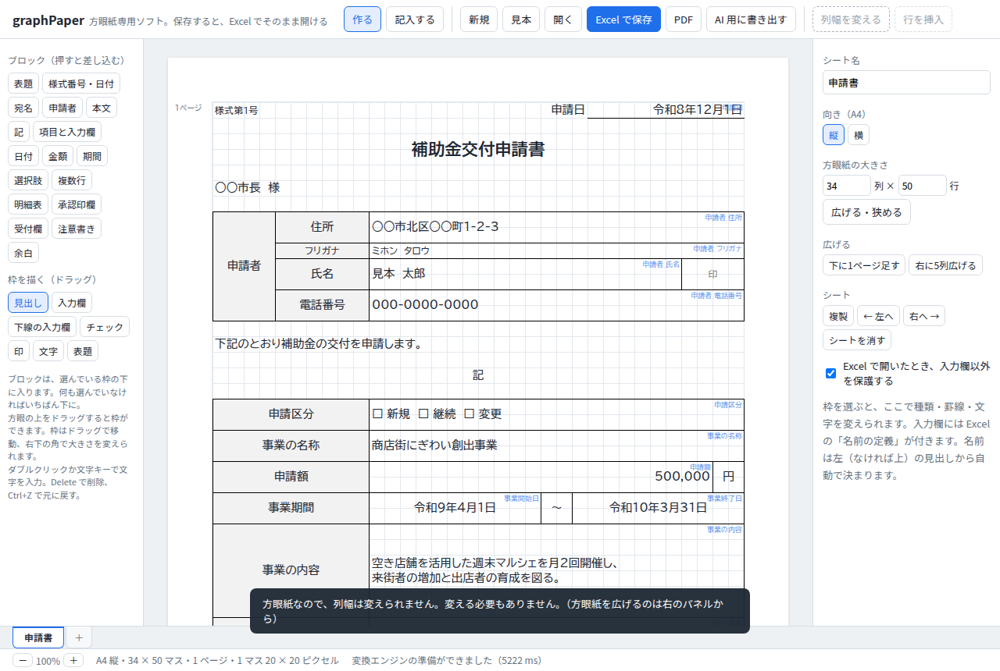

# graphPaper — 方眼紙専用ソフト

Excel 方眼紙を、方眼紙のためだけに作られたソフトで作ります。保存すると普通の `.xlsx` になり、Excel でそのまま開けます。

**[▶ ブラウザで開く](https://ryujiyasu.github.io/graphPaper/)**

インストールは要りません。ブラウザの中だけで動き、作ったファイルや開いたファイルはどこにも送りません。


Excel は表計算ソフトなので、方眼紙のための機能は増えません。方眼紙は今もセル結合と罫線で作ります。それなら方眼紙の専用ソフトを作ればいい、というのが graphPaper です。

## できること

- **枠で描く**：方眼の上をドラッグすると枠ができます。種類は見出し・入力欄・下線の入力欄・チェック・印・文字・表題です。枠はドラッグで動かし、右下の角で大きさを変えます。
- **ブロックを積む**：表題、申請者（住所・フリガナ・氏名・印・電話）、金額、期間、選択肢、明細表、承認印欄、受付欄など 17 種類を用意しています。押すと、選んでいるブロックのすぐ下に差し込まれます。上下の入れ替えもブロック単位です。

  

- **記入する**：「記入する」に切り替えると、入力欄だけに書き込めます。Tab で次の欄へ移ります。日付は和暦で、金額は桁区切りで表示します。

  

- **Excel で保存**：枠はセル結合と罫線になります。入力欄には Excel の「名前の定義」が付き、名前は左（なければ上）の見出しから自動で決まります（例：`申請者_氏名`）。シートは保護され、入力欄以外は触れません（オフにもできます）。
- **シート（タブ）**：様式と記入例のように、1 冊に何枚でも入れられます。複製・並べ替え・名前の変更ができます。
- **方眼紙を広げる・ページを動かす**：A4 の縦・横を選べ、列と行を足せます。印刷は横幅をページに合わせ、縦は次のページへ続きます。ページ単位での入れ替え・追加・削除もできます。
- **Excel 方眼紙を開く**：いまある Excel 方眼紙を読み込むと、列幅・行の高さ・セル結合・罫線をそのまま枠に直し、入力欄を見つけます。名前の定義があればそれを使い、なければ空の罫線枠や色付きのセルから推定します。
- **PDF**：保存した `.xlsx` を、そのままブラウザの中で PDF にします。
- **AI 用に書き出す**：どの欄がどのセルで何が書いてあるかを Markdown にします。方眼紙のまま AI に渡すより、ずっと読みやすい形です。

## できないこと（仕様です）

- **列幅を変える**：方眼紙なので、列幅は変えられません。変える必要もありません。
- **行を挿入する**：印刷がずれるので、できません。ブロックの挿入なら、ずれません。



## しくみ

画面は素の HTML と JavaScript です。`.xlsx` の読み書きと PDF への変換は、Rust と WebAssembly で書かれた文書エンジン [Oxi](https://github.com/Ryujiyasu/oxi)（npm の `@oxidocs/wasm`）がブラウザの中で行います。サーバーはなく、ファイルは手元から出ません。

- `model.js`：枠と方眼、`.xlsx` との行き来（入力欄の検出もここ）
- `blocks.js`：ブロックの定義と、差し込み・入れ替え
- `app.js`：画面
- `template.xlsx`：保存のもとになる空の方眼紙（A4 縦・横の 2 枚）。`make_template.py` で作ります

マスは Excel で 20 × 20 ピクセルの正方形です。標準フォントを游ゴシック 11pt（数字の幅 8 ピクセル）にし、列幅 2.5、行の高さ 15pt にしています。34 × 50 マスが、余白 15 mm の A4 にちょうど収まります。

手元で動かすには、このフォルダーを Web サーバーで配信します（`file://` では動きません）。

```sh
python3 -m http.server 8000
# http://localhost:8000/
```

## ライセンス

MIT または Apache-2.0 のどちらか、お好きな方で。
